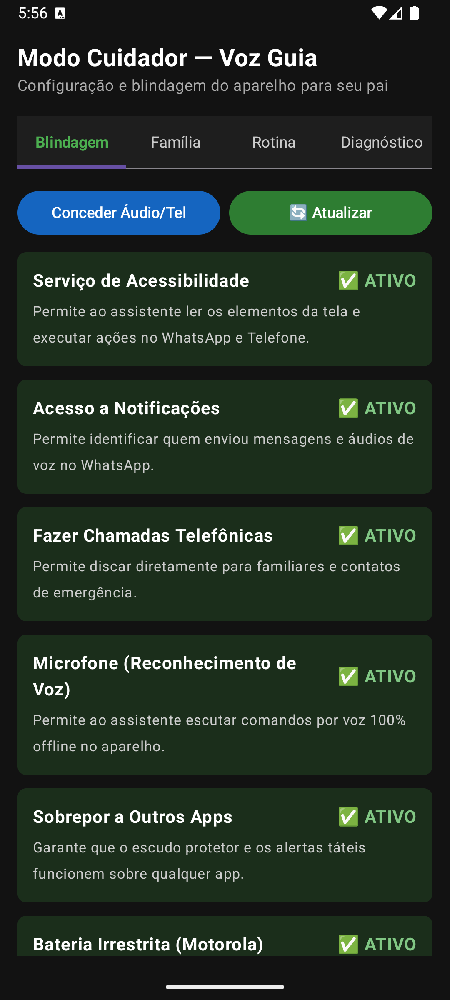
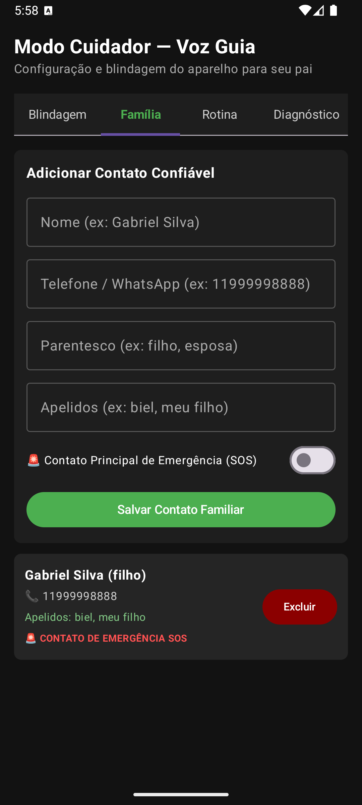
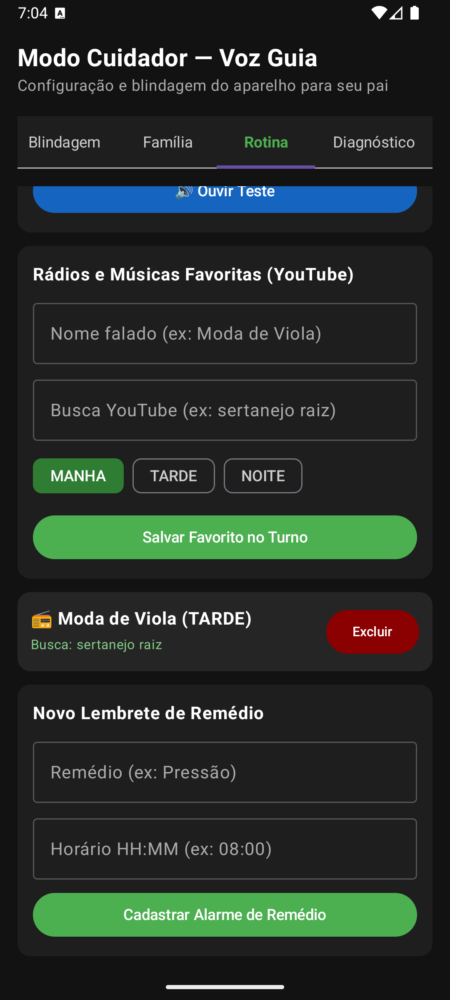
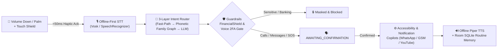

# Voz Guia — AI-Native Android Assistive Agent 🎙️

> 🌐 **English** · [Leia em Português (PT-BR)](README.pt-BR.md)

[-3DDC84.svg?style=for-the-badge&logo=android&logoColor=white)](app/build.gradle.kts)
[](docs/qa-records/2026-11-10/junit_34_suites_results.txt)
[-6366f1.svg?style=for-the-badge)](docs/specs/2026-11-09-voz-guia-visao-e-requisitos.md)
[](docs/specs/epic-1-accessibility-core-haptics.md)

**Conversational, zero-aim native Android accessibility agent engineered to restore smartphone autonomy for users with recent visual loss.**

---

## ⚡ TL;DR — Product Thesis & Engineering Scope

Built from a real accessibility need, **Voz Guia** replaces linear, high-friction screen-reader navigation with a deterministic voice + tactile state machine:

- **Spec-Driven Product Delivery:** Authored full **[PRD v2.0](docs/specs/2026-11-09-voz-guia-visao-e-requisitos.md)** across **5 Epics and 18 Features** with Gherkin acceptance criteria, **[C4 & State Machine architecture](docs/architecture/voz-guia-c4-and-state-machine.drawio)**, and formal security/cost guardrails before writing implementation code.
- **Deterministic UX Contract:** Enforces a **<50ms physical haptic & audio confirmation contract**, edge touch-shielding against accidental taps, and a `AWAITING_CONFIRMATION` Voice 2FA gate for high-impact actions.
- **Verified Quality:** **34 JUnit/MockK test suites / 150 TDD unit tests passing (0 failures)**, emulator E2E validation on Android API 35, and signed release `AAB` configuration.

---

## 📱 Caregiver UI & Emulator QA Gallery

Validated end-to-end on Android API 35 (`medium_phone`) with Room SQLite persistence across `force-stop` and zero `AndroidRuntime` errors ([full QA record](docs/qa-records/2026-11-10/README.md) · [31s Emulator Demo Video (MP4)](docs/qa-records/2026-11-10/vozguia_qa_emulator_demo.mp4)):

| Blindagem (6 Active Permissions) | Família (Room SQLite + Aliases) | Rotina (Offline TTS & Meds) | Diagnóstico (Local Telemetry) |
| :---: | :---: | :---: | :---: |
|  |  |  |  |

---

## 📌 Problem vs. Product Solution

Standard screen readers (**TalkBack**) and cloud voice assistants frequently fail adults who acquired visual loss later in life:

| Native Accessibility Gap | Real User Friction | How **Voz Guia** Solves It |
| :--- | :--- | :--- |
| **Linear, verbose DOM narration** | Reads 20+ UI nodes aloud before reaching the actual content. | **Semantic Screen Parsing:** Filters irrelevant layout noise and summarizes intent conversationally. |
| **Precision gestures & double-taps** | Navigating smooth touchscreens without sight leads to mis-taps and frustration. | **Blind Physical Trigger & Touch Shield:** Long-press `Volume Down` or palm gesture activates voice; edge-touch shield blocks accidental taps. |
| **"Silence in the dark" (3–6s lag)** | Cloud assistants give zero feedback while thinking; blind users assume the phone froze. | **<50ms Haptic & Audio Contract:** Immediate tactile confirmation + periodic haptic heartbeat during processing. |
| **Hostile real-world app flows** | Long YouTube ads or noisy WhatsApp groups trap non-visual navigation. | **Defensive Background Copilots:** Automated ad-skipping in YouTube radio mode, family-prioritized WhatsApp audio handling, and direct voice calling. |

---

## 🏗️ Architecture & Safety Flow



---

## 📦 Product Architecture (5 Epics · 18 Features)

Full product management artifacts and technical specifications are versioned in [`docs/specs/`](docs/specs/):

1. **Epic 1 — Accessibility Core, Physical Triggers & Touch Shield** ([spec](docs/specs/epic-1-accessibility-core-haptics.md)): `AccessibilityService`, physical key interception, `<50ms` haptic feedback mapper, panic-cancel, and touch shield.
2. **Epic 2 — Humanized Voice Engine & 3-Layer Intent Router** ([spec](docs/specs/epic-2-voice-engine-tts-stt.md)): Offline-first TTS/STT orchestration, audio focus coordination, barge-in, and deterministic fast-path routing.
3. **Epic 3 — Autonomous Action Modules** ([spec](docs/specs/epic-3-autonomous-action-modules.md)): WhatsApp Copilot (`NotificationListenerService` + accessibility actions), GSM/VoIP calls, and YouTube radio mode.
4. **Epic 4 — Routine Memory & Phonetic Family Graph** ([spec](docs/specs/epic-4-routine-memory-profile.md)): Phonetic alias resolution (*"meu filho" → Gabriel*), medicine reminders, media favorites, and morning briefings.
5. **Epic 5 — Caregiver Mode, Resilience & Guardrails** ([spec](docs/specs/epic-5-caregiver-mode-safety-resilience.md)): Visual Jetpack Compose dashboard for the caregiver, Room SQLite persistence, battery/watchdog monitoring, and SOS emergency dispatch.

---

## 🛡️ Security, Privacy & Cost Guardrails

Detailed in [`docs/specs/guardrails-security-access-cost-control.md`](docs/specs/guardrails-security-access-cost-control.md) and [`docs/PRIVACY_POLICY.md`](docs/PRIVACY_POLICY.md):

- **Financial & Sensitive Node Shield:** `SensitiveNodeFilter` and `FinancialShieldGuardrail` automatically mask password fields, OTPs, and banking apps so credentials are never spoken aloud.
- **Voice 2FA Confirmation:** High-impact actions (calls, messages, SOS) pass through an explicit confirmation state machine (`AWAITING_CONFIRMATION`).
- **Encrypted Local Persistence:** Trusted contacts and routines live in **Room SQLite**, while usage quota counters are protected via **AES-256 `EncryptedSharedPreferences`** (`androidx.security.crypto`) with `android:allowBackup="false"`.

---

## 🧪 Quality Assurance & Build Verification

- **34 JUnit/MockK test suites / 150 unit tests passing** (0 failures, 0 skipped) — [full suite log](docs/qa-records/2026-11-10/junit_34_suites_results.txt).
- **Emulator E2E validation** on Android API 35 (`medium_phone`): Caregiver UI, Room SQLite persistence across `force-stop`, 6 runtime permissions, and zero `AndroidRuntime` errors — [QA record & video](docs/qa-records/2026-11-10/README.md).
- **Release Readiness:** Signed release bundle (`AAB`) configuration with R8/ProGuard minification and `android:isAccessibilityTool="true"` compliance (`keystore.properties.example` provided; keys excluded from VCS).

---

## 🚀 Running Locally

```bash
# Run all 34 unit test suites (150 TDD tests)
./gradlew testDebugUnitTest

# Build debug APK
./gradlew assembleDebug
```

> **Note:** Release signing requires a local `keystore.properties` and `.jks` file based on [`keystore.properties.example`](keystore.properties.example). Never commit signing credentials.
