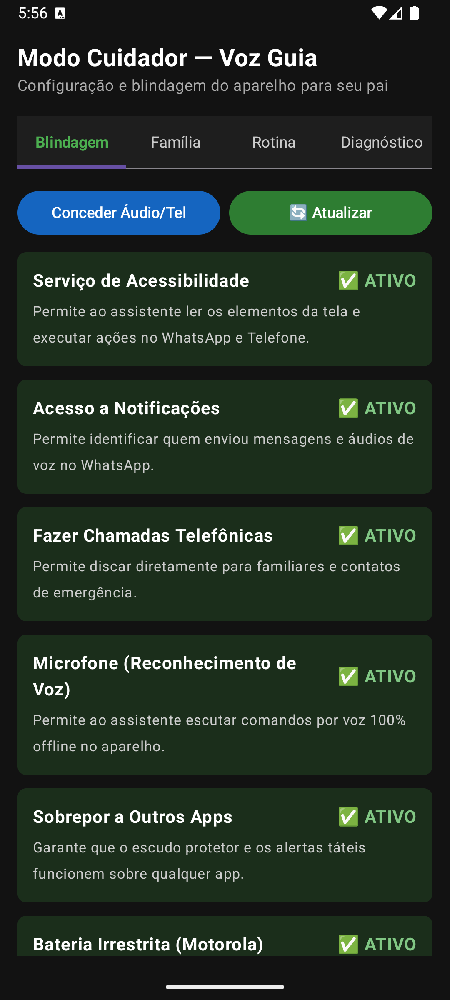
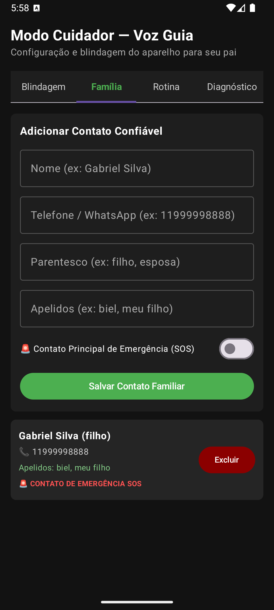
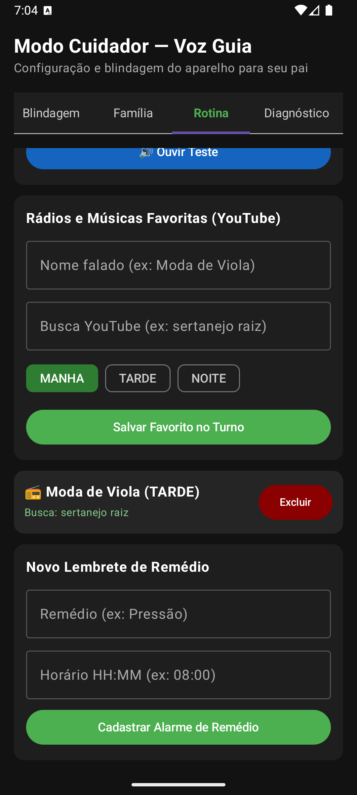
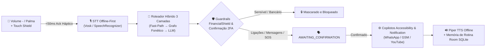

# Voz Guia — Agente Assistivo Nativo Android (AI-Native) 🎙️

> 🌐 [Read in English](README.md) · **Português (PT-BR)**

[-3DDC84.svg?style=for-the-badge&logo=android&logoColor=white)](app/build.gradle.kts)
[](docs/qa-records/2026-11-10/junit_34_suites_results.txt)
[-6366f1.svg?style=for-the-badge)](docs/specs/2026-11-09-voz-guia-visao-e-requisitos.md)
[](docs/specs/epic-1-accessibility-core-haptics.md)

**Agente de acessibilidade conversacional nativo para Android, projetado para devolver autonomia no uso do smartphone a pessoas com perda visual recente.**

---

## ⚡ Resumo Executivo — Tese de Produto e Escopo

Nascido de uma necessidade real de acessibilidade familiar, o **Voz Guia** substitui leitores de tela lineares e cheios de atrito por uma máquina de estados determinística por voz e retorno tátil:

- **Entrega Orientada a Spec:** **[PRD v2.0](docs/specs/2026-11-09-voz-guia-visao-e-requisitos.md)** completo com **5 Épicos e 18 Funcionalidades**, critérios Gherkin, **[arquitetura C4 e máquina de estados](docs/architecture/voz-guia-c4-and-state-machine.drawio)** e guardrails formais antes da primeira linha de Kotlin.
- **Contrato Determinístico de UX:** Garante feedback háptico e sonoro em **<50ms**, escudo contra toques acidentais na borda da tela e confirmação vocal 2FA (`AWAITING_CONFIRMATION`) para ações críticas.
- **Qualidade Verificada:** **34 suítes JUnit/MockK / 150 testes TDD aprovados (0 falhas)**, validação E2E em emulador Android API 35 e configuração de bundle `AAB` assinado para Play Console.

---

## 📱 Galeria de QA no Emulador (Modo Cuidador)

Validado ponta a ponta no Android API 35 (`medium_phone`) com persistência em Room SQLite após `force-stop` e zero exceções `AndroidRuntime` ([registro completo de QA](docs/qa-records/2026-11-10/README.md) · [Vídeo Demo no Emulador (31s MP4)](docs/qa-records/2026-11-10/vozguia_qa_emulator_demo.mp4)):

| Blindagem (6 Permissões Ativas) | Família (Room SQLite + Apelidos) | Rotina (TTS Offline & Remédios) | Diagnóstico (Telemetria Local) |
| :---: | :---: | :---: | :---: |
|  |  |  |  |

---

## 📌 Problema vs. Solução de Produto

Leitores de tela tradicionais (**TalkBack**) e assistentes genéricos falham com adultos que perderam a visão recentemente:

| Lacuna Nativa | Atrito Real do Usuário | Como o **Voz Guia** Resolve |
| :--- | :--- | :--- |
| **Narração linear e verbosa do DOM** | Lê mais de 20 nós de UI antes de chegar ao conteúdo útil. | **Parsing Semântico de Tela:** Filtra ruído de layout e resume a intenção em linguagem natural. |
| **Gestos de precisão e duplo toque** | Tocar telas lisas sem enxergar gera cliques acidentais e frustração. | **Gatilho Físico & Touch Shield:** Segurar `Volume -` ou gesto com a palma ativa a voz; escudo bloqueia toques na borda. |
| **"Silêncio no escuro" (3–6s de latência)** | Assistentes em nuvem ficam mudos ao pensar; o usuário acha que travou. | **Contrato Háptico <50ms:** Confirmação tátil imediata + batimento háptico periódico durante o processamento. |
| **Fluxos hostis em apps do dia a dia** | Anúncios longos no YouTube ou grupos no WhatsApp prendem o usuário. | **Copilotos Defensivos:** Pulo automático de anúncios no YouTube modo rádio, triagem de áudios familiares e discagem direta. |

---

## 🏗️ Arquitetura e Fluxo de Segurança



---

## 📦 Arquitetura de Produto (5 Épicos · 18 Funcionalidades)

Especificações completas versionadas em [`docs/specs/`](docs/specs/):

1. **Épico 1 — Core de Acessibilidade, Gatilhos Físicos & Touch Shield** ([spec](docs/specs/epic-1-accessibility-core-haptics.md))
2. **Épico 2 — Motor de Voz Humanizado & Roteador de Intenção em 3 Camadas** ([spec](docs/specs/epic-2-voice-engine-tts-stt.md))
3. **Épico 3 — Módulos de Ação Autônoma (WhatsApp, Chamadas, YouTube Rádio)** ([spec](docs/specs/epic-3-autonomous-action-modules.md))
4. **Épico 4 — Memória de Rotina & Grafo Fonético Familiar** ([spec](docs/specs/epic-4-routine-memory-profile.md))
5. **Épico 5 — Modo Cuidador, Resiliência & Guardrails** ([spec](docs/specs/epic-5-caregiver-mode-safety-resilience.md))

---

## 🛡️ Segurança, Privacidade & Controle de Custos

Detalhado em [`docs/specs/guardrails-security-access-cost-control.md`](docs/specs/guardrails-security-access-cost-control.md) e [`docs/PRIVACY_POLICY.md`](docs/PRIVACY_POLICY.md):

- **Blindagem Financeira e de Campos Sensíveis:** `SensitiveNodeFilter` e `FinancialShieldGuardrail` mascaram senhas, OTPs e apps bancários para nunca serem narrados em voz alta.
- **Confirmação Vocal 2FA:** Ações críticas passam obrigatoriamente pela máquina de estados `AWAITING_CONFIRMATION`.
- **Persistência Local Criptografada:** Contatos/rotinas no **Room SQLite** e cotas protegidas via **AES-256 `EncryptedSharedPreferences`** (`android:allowBackup="false"`).

---

## 🧪 Garantia de Qualidade e Execução Local

```bash
# Rodar todas as 34 suítes unitárias (150 testes TDD)
./gradlew testDebugUnitTest

# Gerar APK de debug
./gradlew assembleDebug
```

> **Nota:** Assinatura de release exige `keystore.properties` e arquivo `.jks` locais baseados em [`keystore.properties.example`](keystore.properties.example). Nunca versione credenciais de assinatura.
