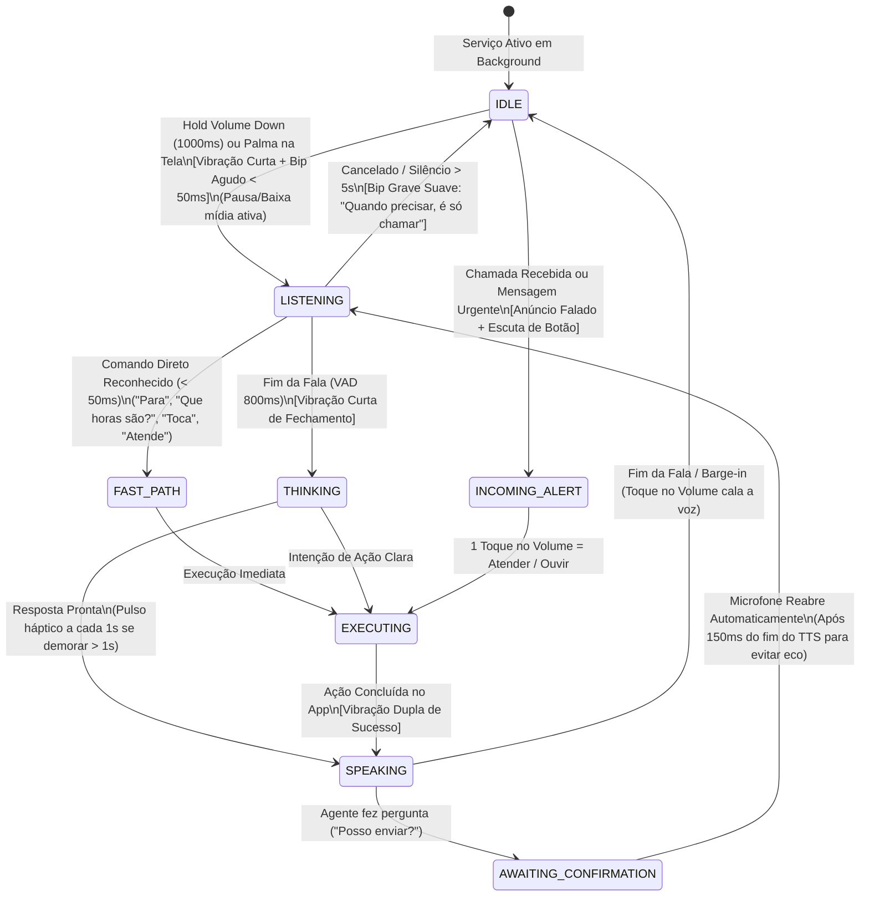

# Voz Guia — PRD Executivo, Visão de Produto, Arquitetura e Mapa de Épicos

- **Versão:** 2.0 (Especificação Funcional Aprofundada — Senior PM Review)
- **Data:** 2026-11-09
- **Status:** Aprovado para Planejamento de Engenharia
- **Product Manager:** Antigravity & Gabriel
- **Usuário Primário:** Pai do Gabriel (deficiência visual adquirida recentemente)
- **Usuário Secundário (Administrador/Cuidador):** Gabriel (filho, vidente, responsável pelo setup inicial e curadoria de rotina)
- **Dispositivo Alvo Homologado:** Motorola Edge 50 Neo (SoC MediaTek Dimensity 7300 4nm, NPU MediaTek APU 655, 8GB/12GB RAM, 256GB UFS, Android 14/15 — Hello UI)

---

## 1. Sumário Executivo e Diagnóstico de Produto

### 1.1 Por que os Leitores de Tela Atuais Falham na Perda Visual Recente?
O **TalkBack** (Google) e o **Google Assistente** foram projetados sob premissas que colapsam quando aplicadas a um adulto/idoso que perdeu a visão recentemente:

| Falha dos Sistemas Nativos | Impacto Real no Usuário (Pai do Gabriel) | Como o **Voz Guia** Resolve na Raiz |
| :--- | :--- | :--- |
| **1. Leitura Linear e Verbosa da Árvore DOM** | O TalkBack lê *"Botão não marcado, lista com 18 itens, foto de perfil, 14:32, toque duas vezes para ativar"*. Gera exaustão mental e desorientação espacial. | **Síntese Semântica Conversacional:** Filtra 90% dos nós visuais irrelevantes e fala apenas o que um humano diria: *"O Gabriel mandou um áudio agora há pouco. Quer ouvir?"*. |
| **2. Exigência de Toque Duplo e Gestos Espaciais** | Sem visão, acertar dois toques rápidos no mesmo ponto ou fazer gestos em "L" na tela lisa com bordas curvas do Edge 50 Neo resulta em cliques errados e frustração. | **Interação Física Sem Mira + Escudo de Tela:** Tudo funciona segurando um único botão físico (`Volume Menos`) ou tocando com a palma inteira, enquanto um escudo bloqueia toques acidentais das bordas. |
| **3. O "Vazio no Escuro" (Latência Muda)** | O Google Assistente fica de 3 a 6 segundos em silêncio absoluto processando na nuvem. Para quem não vê a bolinha girando na tela, o silêncio parece que o celular morreu ou não ouviu. | **Contrato Háptico < 50ms + Heartbeat Tátil:** Vibração e som afirmativo em menos de 50ms no ato do aperto, seguidos de pulsos suaves se o processamento passar de 1 segundo. |
| **4. Armadilhas de Apps Reais (Anúncios do YouTube, Grupos de WhatsApp)** | No YouTube, entra um comercial de 3 minutos e a pessoa cega não consegue clicar em *"Pular anúncio"*. No WhatsApp, grupos barulhentos soterram as mensagens da família. | **Automação Defensiva em Background:** Clica sozinho em *"Pular anúncio"* no YouTube, bloqueia queda em *YouTube Shorts* e prioriza contatos da família sobre grupos no WhatsApp. |

---

## 2. Personas do Produto

### Persona 1: O Usuário Principal (Pai do Gabriel)
- **Perfil:** Perdeu a visão recentemente; possui memória conceitual de como o mundo funciona, mas não domina (e não quer dominar) jargões de informática ou gestos acrobáticos de acessibilidade.
- **Canais vitais:** WhatsApp (ouvir e mandar áudios para a família), Telefone (fazer e atender ligações) e YouTube (ouvir músicas, notícias, programas e podcasts como se fosse um rádio inteligente).
- **Necessidades emocionais:** Autonomia, segurança de que está no controle, nunca ficar "no escuro" sem resposta, poder cancelar qualquer coisa imediatamente se ficar confuso.

### Persona 2: O Familiar Configurador (Gabriel)
- **Perfil:** Filho, experiente em tecnologia, que configura o celular para o pai.
- **Necessidades:** Uma tela visual limpa (**Modo Cuidador**) onde possa cadastrar os contatos principais com seus apelidos familiares (*"meu filho" → Gabriel*), configurar canais favoritos do YouTube, ajustar a velocidade da voz e desativar temporariamente o bloqueio de tela quando precisar dar manutenção no aparelho.

---

## 3. Máquina de Estados Finita da Experiência (UX State Machine)

Para que o usuário nunca se perca, o **Voz Guia** opera sob uma máquina de 6 estados determinísticos, onde cada transição possui uma assinatura tátil (vibração) e sonora própria:

---

## 4. Arquitetura de Épicos e Matriz de Features (Visão Consolidada)

Após revisão sênior de produto, o projeto foi estruturado em **5 Épicos** e **18 Features**:

| Épico | Código | Feature | Prioridade MVP |
| :--- | :--- | :--- | :--- |
| **Épico 1: Core de Acessibilidade, Gatilhos Físicos & Escudo de Tela** | `FEAT-1.1` | Serviço Nativo `AccessibilityService` & Despachante de Gestos | **P0 (Blocker)** |
| | `FEAT-1.2` | Gatilho Físico sem Mira (Hold `Volume Down` & Despertar de Tela) | **P0 (Blocker)** |
| | `FEAT-1.3` | Motor Háptico/Sonoro `< 50ms` & *Heartbeat* de Processamento | **P0 (Blocker)** |
| | `FEAT-1.4` | Botão Universal de Pânico/Silêncio (*Panic Cancel*) | **P0 (Blocker)** |
| | `FEAT-1.5` | Escudo de Tela Contra Toques Acidentais (*Touch Shield*) e Gesto de Palma | **P1 (Alta)** |
| **Épico 2: Motor de Voz Humanizada, Áudio & Inteligência Híbrida** | `FEAT-2.1` | Síntese de Voz Neural Humanizada pt-BR com *Barge-in* Instantâneo | **P0 (Blocker)** |
| | `FEAT-2.2` | Reconhecimento de Voz Offline (STT) com VAD Adaptativo e Anti-Eco | **P0 (Blocker)** |
| | `FEAT-2.3` | Controle Inteligente de `AudioFocus`, *Audio Ducking* e Roteamento (Fone/Viva-Voz) | **P0 (Blocker)** |
| | `FEAT-2.4` | Roteador de Intenção em 3 Camadas (*Fast-Path < 50ms* + *SLM On-Device* + *Cloud Fallback*) | **P0 (Blocker)** |
| **Épico 3: Módulos de Ação Autônoma (WhatsApp, Telefone & YouTube)** | `FEAT-3.1` | **WhatsApp Copiloto:** Resumo Familiar (`NotificationListener`), Play de Áudios e Envio Guiado | **P0 (Blocker)** |
| | `FEAT-3.2` | **Telefone & Chamadas:** Discagem por Apelido, Viva-Voz Automático e Atendimento por Botão (GSM + WhatsApp) | **P0 (Blocker)** |
| | `FEAT-3.3` | **YouTube Modo Rádio:** Busca Direta, Auto-Skip de Anúncios (*Ad-Skipper*) e Bloqueio de *Shorts* | **P0 (Blocker)** |
| **Épico 4: Memória de Rotina, Grafo Familiar & Autonomia Diária** | `FEAT-4.1` | Grafo Familiar e Dicionário Fonético Local (SQLite) | **P0 (Blocker)** |
| | `FEAT-4.2` | Utilidades Instantâneas de Autonomia (Hora, Data, Nível de Bateria, Alarme/Remédio) | **P0 (Blocker)** |
| | `FEAT-4.3` | Aprendizado de Favoritos de Mídia e Rádio Matinal | **P1 (Alta)** |
| | `FEAT-4.4` | Briefing Matinal Acolhedor no Primeiro Uso do Dia | **P1 (Alta)** |
| **Épico 5: Modo Cuidador (Familiar), Segurança & Resiliência** | `FEAT-5.1` | Painel Visual do Familiar (Cadastro de Contatos/Apelidos, Ajuste de Voz e Bypass de Tela) | **P0 (Blocker)** |
| | `FEAT-5.2` | Guardião de Bateria, Sobrevivência em Background (Motorola Tuning) e Comando de Emergência SOS | **P1 (Alta)** |

---

## 5. Requisitos Não-Funcionais (RNFs) e SLAs de Qualidade

1. **RNF-01 (Latência de Feedback de Gatilho):** $\le 50\text{ ms}$ entre o evento físico de `Hold Volume Down` e o início da vibração + bip sonoro.
2. **RNF-02 (Latência de Comandos Fast-Path):** $\le 150\text{ ms}$ após o fim da fala para comandos determinísticos locais (*"Que horas são?"*, *"Quanta bateria tem?"*, *"Para"*, *"Pausa"*).
3. **RNF-03 (Prevenção de Eco Acústico):** O microfone do STT deve permanecer mutado durante 100% da fala do TTS + `150ms` após o evento `onDone` do sintetizador de voz.
4. **RNF-04 (Carga Cognitiva Máxima):** Nenhuma resposta falada do agente pode ultrapassar **25 segundos** ou oferecer mais de **2 opções de escolha** simultâneas ao usuário.
5. **RNF-05 (Consumo de Bateria):** O serviço em estado `IDLE` não pode consumir mais de **3% de bateria por hora**, mantendo os modelos pesados dormindo até que o gatilho físico seja acionado.
6. **RNF-06 (Privacidade Zero-Trust):** Mensagens do WhatsApp, contatos e gravações de voz são processados localmente na memória do aparelho; o fallback de nuvem (opcional) só é acionado para buscas abertas ou descrição de imagens sob pedido explícito.

---

## 6. Índice da Documentação Detalhada por Épico

- [Épico 1 — Core de Acessibilidade, Gatilhos Físicos & Escudo de Tela](file:///D:/Projetos/voz-guia-android/docs/specs/epic-1-accessibility-core-haptics.md)
- [Épico 2 — Motor de Voz Humanizada, Áudio & Inteligência Híbrida](file:///D:/Projetos/voz-guia-android/docs/specs/epic-2-voice-engine-tts-stt.md)
- [Épico 3 — Módulos de Ação Autônoma (WhatsApp, Telefone & YouTube)](file:///D:/Projetos/voz-guia-android/docs/specs/epic-3-autonomous-action-modules.md)
- [Épico 4 — Memória de Rotina, Grafo Familiar & Autonomia Diária](file:///D:/Projetos/voz-guia-android/docs/specs/epic-4-routine-memory-profile.md)
- [Épico 5 — Modo Cuidador (Familiar), Segurança Operacional & Resiliência](file:///D:/Projetos/voz-guia-android/docs/specs/epic-5-caregiver-mode-safety-resilience.md)
- [Diagrama de Arquitetura e Máquina de Estados (Draw.io)](file:///D:/Projetos/voz-guia-android/docs/architecture/voz-guia-c4-and-state-machine.drawio)
