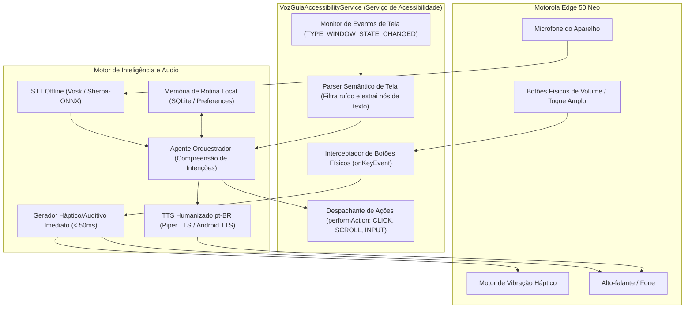

# Voz Guia — Visão de Produto, Requisitos Humanos e Arquitetura

- **Data:** 2026-11-09
- **Status:** Especificação Inicial / Alinhamento de Produto
- **Autor:** Gabriel (com Antigravity)
- **Usuário Primário:** Pessoa com deficiência visual recente (pai do Gabriel).
- **Dispositivo Alvo:** Motorola Edge 50 Neo (MediaTek Dimensity 7300, NPU APU 655, 8GB/12GB RAM, Android 14/15).

---

## 1. O Problema Humano e a Tese de Valor

### 1.1 O Diagnóstico da Dor Real
Pessoas que perderam a visão recentemente enfrentam um choque de usabilidade com os recursos nativos do smartphone:

1. **O TalkBack é verboso, mecânico e exaustivo:** Ele lê a estrutura do código da tela (nós de acessibilidade, rótulos técnicos, itens não clicáveis, anúncios) em vez de sintetizar o que realmente importa. Para ouvir uma mensagem de áudio, o usuário precisa passar por dezenas de elementos irrelevantes.
2. **O gesto de Toque Duplo é um obstáculo físico:** Exige acertar o mesmo milímetro espacial da tela em fração de segundo. Para quem perdeu a visão adulta ou recentemente, a coordenação motora fina espacial sem feedback visual causa frustração e toques errados constantes.
3. **O "Vazio no Escuro" dos assistentes de voz tradicionais:** Comandos de voz convencionais (como Google Assistente) dependem de processamento na nuvem que muitas vezes deixa o usuário 3 a 5 segundos em silêncio absoluto sem qualquer retorno. Para quem não enxerga, o silêncio gera incerteza e pânico (*"O celular travou? Ele me ouviu? Deu erro?"*).

### 1.2 A Tese do Voz Guia
> O celular deve agir como um **assistente pessoal presente e acolhedor**, eliminando a necessidade de mirar na tela. Ele opera por **gatilhos físicos simples**, responde com **feedback háptico/sonoro imediato (< 50ms)**, resume a tela com inteligência semântica e executa tarefas autônomas nos aplicativos mais vitais (WhatsApp, Telefone e YouTube).

---

## 2. Requisitos Humanos e Princípios de Design Acessível (a11y)

| Princípio | Descrição Operacional | Implementação Técnica |
| :--- | :--- | :--- |
| **P-01: Zero Silêncio no Escuro** | O usuário NUNCA fica em dúvida se o sistema ouviu seu comando. Ao acionar o microfone ou botão, o retorno háptico/auditivo ocorre em menos de 50 milissegundos. | Vibração curta no motor háptico + Bip de confirmação local imediato antes mesmo de chamar qualquer LLM. |
| **P-02: Acionamento Sem Mira** | Eliminar a dependência de tocar em botões pequenos ou acertar toque duplo em coordenadas espaciais precisas. | Gatilho físico: segurar botão de volume para baixo por 1s, OU toque amplo com a palma da mão na tela. |
| **P-03: Resumo Semântico em vez de Leitura Bruta** | Não ler a árvore DOM/XML de acessibilidade. Sintetizar a intenção da tela em linguagem natural. | Um nó com 15 mensagens no WhatsApp vira: *"O Gabriel mandou 2 áudios perguntando se você almoçou. Deseja ouvir agora?"*. |
| **P-04: Voz Humanizada e Ritmo Calmo** | Voz neural brasileira calorosa, com entonação amigável e dicção clara, distante da voz metálica do TalkBack. | Síntese de fala local (Piper TTS / Android Neural TTS) configurada com cadência suave. |
| **P-05: Operação On-Device (Resiliente a Falhas de Internet)** | As ações fundamentais (ligar, ler notificações recebidas, abrir YouTube) devem funcionar offline. | STT local leve + modelos on-device (Gemma 2B / Qwen 1.5B via NPU do Dimensity 7300). |

---

## 3. Arquitetura de Sistema no Android

O projeto será implementado em **Kotlin nativo** utilizando as seguintes fundações do sistema operacional:

---

## 4. Segmentação em Épicos de Implementação

O desenvolvimento do MVP funcional será dividido em **4 Épicos**:

1. **Épico 1 — Core de Acessibilidade & Gatilhos Físicos:** Criação do `AccessibilityService`, captura de eventos do sistema, interceptação de botões de volume sem interferir no controle normal de som, e o subsistema de **Feedback Háptico Imediato (< 50ms)**.
2. **Épico 2 — Motor de Voz Humanizada & Entrada Auditiva:** Integração do TTS neural natural em português e do reconhecimento de fala (STT) local de baixa latência.
3. **Épico 3 — Módulos Especializados de Ação Autônoma:**
   - **WhatsApp:** Leitura resumida de mensagens, reprodução de áudios e envio guiado de mensagens de voz.
   - **Telefone:** Discagem inteligente por apelidos familiares ("liga pro Gabriel", "liga pro meu filho") com ativação automática de viva-voz opcional.
   - **YouTube (Modo Rádio/Podcast):** Busca por voz, seleção do conteúdo mais relevante e play automático em tela cheia.
4. **Épico 4 — Memória de Rotina & Perfil Pessoal:** Aprendizado de contatos frequentes, hábitos de horários, canais de rádio/YouTube favoritos e respostas rápidas personalizadas.
